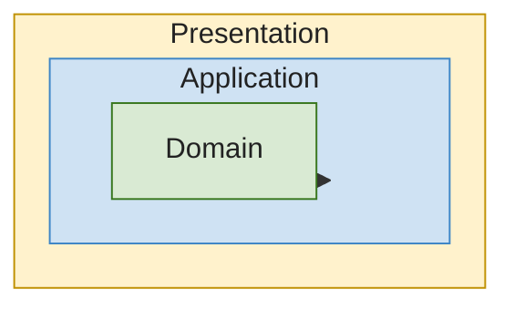

# Codebase Design

Guidlines for practices to follow for good codebase design for non UI applications such as API's, CLI's and redistributable libraries and packages

## Layering

Implement a closed, layered architecture. That means, there is no specified number of layers but each layer must only interact with the layer directly beneath it. 

Generally speaking, a codebase should generally have the following layers to ensure clean separation of concerns. Working from the innermost layer to the outermost.

### Domain
The Domain Layer contains the core business model, rules and behaviour of the application.

Its responsibilities include:
- Entities: Objects with identity and lifecycle.
- Value Objects: Immutable concepts defined by their values.
- Aggregates: Consistency boundaries that enforce business invariants.
- Domain Services: Business operations that don't naturally belong to a single entity or value object.
- Domain Events: Represent significant events within the business domain.
- Domain Rules: Enforce business constraints and invariants.

Important distinctions:
- The Domain Layer should be independent of application, presentation and infrastructure concerns.
- Domain services implement business logic; application services orchestrate use cases.
- Domain objects should encapsulate behaviour rather than merely hold data.
- The Domain Layer should not depend on databases, web frameworks or external services.

### Application

The Application Layer is commonly described as the orchestration layer.

Its responsibilities include:
- Coordinating domain entities, aggregates and domain services.
- Executing application use cases.
- Managing transaction boundaries.
- Coordinating persistence through abstractions (Abstractions which are defined in the domain layer).
- Applying application-level concerns such as authorisation, logging and validation.

Important distinctions:
- Application services should orchestrate business operations, not implement core domain business rules.
- Not every use case requires multiple domain services.
- Cross-cutting concerns are often implemented through middleware, decorators or pipelines rather than directly in application services.

### Presentation

In non UI codebases Both REST APIs and CLI interfaces are examples of the Presentation Layer. Importantly, the presentation layer is commonly not a graphical user interface. For a desktop application this would probably be the case but for other cases, presentation of the interface to the application stack is usually an API or CLI. Graphical interfaces in these cases should be considered separate codebases with their own independent layering. This applies even when the GUI is a web application in the same source code repository as the API or CLI.

Presentation responsibilities include:
- Providing the interface into the application.
- Accepting input and returning output.
- Input validation (format, required fields).
- Translating external requests into application commands or queries.
- Delegating execution to the Application Layer.

Important distinctions:
- The Presentation Layer handles external input and output, not business logic.
- It should delegate use-case execution to the Application Layer.
- Input validation concerns include syntax, format and required fields whilst business validation belongs in the Application or Domain Layer.
- Authentication is typically handled at the presentation boundary whilst authorisation may also be enforced in the Application Layer.
- It translates external representations (HTTP requests, CLI arguments) into application commands or queries, and application results into responses.
- It should not directly access persistence infrastructure or bypass the Application Layer to execute business operations.
- It should remain replaceable without requiring changes to the Application or Domain Layers.

### How to layer

Although laying typically involves splitting up a codebase into distinct layers by project, this is not always needed.

Layers can exist in a single project simply by using an appropriate directory structure and namespacing whilst enforcing the layering in-code. Good layering in a single project should mean that at any point, a directory or group of directories could be removed and placed into a separate project with minor refactoring to the classes that referenced the moved artifacts. 

#### Naming & Organisation

 - Never use the word "Domain" as a directory name, class or namespace. For Project naming use "Core" instead. 
 - "Application" may be used as the name for a project but must not be used as a directory name, see details below on bundling

Bundling: This is an antipattern where an entire layer is bundled under a single directory. Do not Create a directory called "Domain" or "Application" or "Presentation" and put everything related to the layer in there. Layers are an abstracted concept that form organically through correct separation of concerns, responsibilities and dependencies.

Example of a simplt but well-structured C# monorepo project 

### The infrastructure layer 

The infrastructure layer is commonly referenced in literature about application layering to make it clear that the concrete implementations for ancillary services like a database or external API's shouldn't live in the domain layer. Only the abstracted interface should live in the domain layer so that business rules can be encapsulated there without polluting the layer with non-domain related code. 

This reasoning holds true but the word "infrastructure" has become incredibly confusing with the advent of cloud-native applications and services. Infrastructure is almost unanimously used to describe the physical infrastructure used to host and run the application or service. 

Avoid using the term "infrastructure" when reviewing layering, instead find alternate ways to describe why an implementation may be incorrect.

The ifra layer should be something that occurs naturally with good practices. In the example above, the EfCore project forms the infra layer, implementing the interface defined in core.